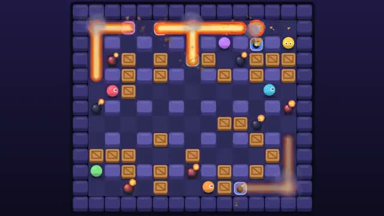

# Bomb Arena

Drop bombs, break crates, be the last one standing. A multiplayer starter game from [Multiplayer Agent](https://multiplayeragent.com): 2D, versus, 2–8 players, with bots that fill the arena up to four.

## How it plays

Drop bombs to blast crates open and catch rivals in the cross-shaped flames; a blast sets off any bomb it reaches. Crates hide power-ups: more bombs, longer blasts, speed and kicking bombs. When the timer runs out the walls close in. First to 3 round wins takes the match.

**Controls:** Arrow keys or WASD to move, Space to drop a bomb; on touch, the D-pad and the bomb button.

## Make it yours in the Game Builder

Open the [Game Builder](https://multiplayeragent.com), choose **Start from a starter game** and pick Bomb Arena. It opens as version 1 in your studio, ready to play and publish. Then ask for changes, for example:

- Add a power-up that lets you throw bombs over walls
- Make the arena an ice rink where players slide until they hit something
- Add two teleport pads in opposite corners

## Run it yourself

1. Get a free publishable key (`pk_…`) at [multiplayeragent.com](https://multiplayeragent.com).
2. In `index.html`, put it in place of `pk_REPLACE_ME` in the `MP_CONNECT` block.
3. Open `index.html` in a browser. No build step and no server needed.

Without a key it still runs, offline against bots.

## How it is built

- One `index.html`. The comment at the top of the script maps the code and explains the multiplayer.
- The arena size, fuse, blast length, speeds, power-up odds, round timer and bot behavior are all in `CONFIG`.
- **Host-run rules:** The host's browser times every bomb, resolves the blasts and decides who got caught; if it leaves, the next player takes over.
- **Bots:** Bots fill the arena up to four players. They bomb crates and rivals and run from blasts. Someone who joins mid-round takes over a bot's seat.
- **Leaderboard:** Rounds won, all time, shown at the end of each match.
- **Live sync:** Every bomb goes off on every screen at the same moment.
- `?attract` runs it offline with bots only. The preview video is recorded from it.

## License

MIT.
